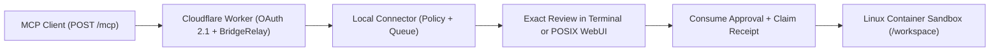

<h1 align="center">LoomWard</h1>

<p align="center">
  <a href="LICENSE"></a>
  <a href="package.json"></a>
  <a href="pnpm-workspace.yaml"></a>
  <a href="wrangler.jsonc.example"></a>
</p>

<p align="center">
  <a href="README.md">简体中文</a> | <strong>English</strong>
</p>

<p align="center">
  <a href="https://agentdock-worker-remote.cbnv.me/en/">Live Documentation</a> · <a href="docs-site/en/index.md">Docs Source</a> · <a href="repo-docs/README.md">Source Walkthrough (ZH)</a>
</p>

Personal local Agent security and control plane (evolved from `AgentDock Bridge` into the **LoomWard** `pnpm workspace` monorepo): built on a **Cordis 4** microkernel with frozen Root Plugin Manifests (RPM) and stateless `PolicyTree` guards, unifying Cloudflare Workers OAuth 2.1 remote MCP relay, exact local approval on Windows/macOS/Linux, disposable read-only Linux Docker sandboxes, third-party MCP aggregation, R1–R7 anti-leak guardrails, and a Human-Agent decision ledger.

## Monorepo Layout & Archive Branches

Workspace packages live under `packages/*` (core root packages) and `plugins/*` (strictly `out-of-process` extensions), while the existing v2 bridge runtime (`cloud/`, `local/`, `container/`, `scripts/`, `test/`) stays active and regression-tested during incremental migration:

- **Core Packages (`packages/*`)**: `@loomward/shared` (zero-host contracts, declarative `console:panel@1`, zero-coupling `ContentInspect v1`, monotonic safety slots), `@loomward/kernel` (Cordis 4 + `KernelGuard` + frozen RPM + `PolicyTree` + `pnpm run layering`), `@loomward/cloud-relay`, `@loomward/sandbox`, `@loomward/host` (`ToolDispatchPipeline` + daemon), `@loomward/console` (physical Ring 2 Trust Origin `18798` + Ring 3 read-only Console Origin `18797` + `0600` `control.sock` + offline `esbuild` web bundles).
- **Platform Plugins (`plugins/*`, strictly `out-of-process`)**: `@loomward/plugin-antileak` (offline R1–R7 fail-closed pre-inspection from `archive/claude-code-antileak-hooks`), `@loomward/plugin-decisions` (loopback Python+SQLite ledger with CAS/idempotency from `archive/agent-decisions-dashboard`), `@loomward/plugin-mcp-hub`, and `@loomward/plugin-adapters` (OAuth 2.1 Streamable HTTP MCP for standalone **CloudForge** + read-only 12s-bounded telemetry for standalone **ModelBridge**, without touching either repo).
- **Archive Branches**: `archive/agentdock-worker-remote`, `archive/agent-decisions-dashboard`, and `archive/claude-code-antileak-hooks` preserve the complete signed pre-consolidation histories.

## Core Capabilities & Flow

- **Edge OAuth 2.1 with Password-Generation Isolation**: Splits `AuthCoordinator` and `BridgeRelay` across two SQLite Durable Objects, requiring PKCE `S256`, zero-script CSP consent HTML, and refresh-token family revocation; rotating the owner password advances the generation prefix and immediately invalidates old grants.
- **Exact Local Approval & Pre-Execution Replay Ledger**: Except for context/status/stop controls, every tool invocation binds `origin`, client identity, scopes, method, and full arguments into a canonical SHA-256 digest for manual review in `Approve.cmd` on Windows, or through `approve` or the authenticated loopback WebUI on Linux and macOS; retries consume the approval file before claiming a 24-hour durable receipt.
- **Disposable Linux Container Sandbox & File Policy**: Commands and file operations execute under an unprivileged child UID/GID (`1000` on Windows/macOS Docker Desktop, or dynamically matched to the non-root host UID/GID on native Linux) with `--read-only`, `--cap-drop ALL` (retaining only `SETUID`/`SETGID`), `no-new-privileges`, and `--network none` by default; `file-safety` rejects symlinks, multi-hardlinks, malformed Unicode, and custom Windows DACL replacement.
- **Fail-Closed Cleanup Guard**: Any unconfirmed `docker rm -f` halts all new file or command operations while keeping `command_status` and `stop_command` available to the owning client without falsely reporting cleanup success.
- **Hardened Host Copy & Pinned Toolchain**: Isolates config, secrets, and runtime files into `~/.agentdock-bridge` (`%USERPROFILE%\.agentdock-bridge` on Windows), verifies ancestor directory permissions, OS credential protection (Windows DPAPI, macOS Keychain, or Linux Secret Service / `0600` file), and pinned Node `24.22.1` SHA-256 checksums, and clears preload/dynamic-linker override variables on launch.

## Capabilities & Explicit Non-Goals

| Dimension | What AgentDock Bridge Delivers | Explicit Non-Goals & Hard Bounds |
| --- | --- | --- |
| Cloud Auth & Relay | OAuth 2.1 + PKCE S256, zero-script CSP consent HTML, generation-based password invalidation, outbound `WSS /bridge` | **No** multi-tenancy (single `owner` only) or SSE response streaming; Cloudflare & upstream AI platforms see payloads |
| Local Approval | All tools outside `computer_context`, `command_status`, `stop_command` require exact local approval in the terminal or POSIX WebUI | `5`-minute pending TTL (`64` queue cap); **zero auto-replay** on `504`; headless Linux without a keyring uses `0600` file secrets |
| Tools & Sandbox | 10 MCP tools isolated in `--read-only`, `--cap-drop ALL`, unprivileged UID, `--network none` Linux containers | `1 MiB` RPC / `2 MiB` reply / `110s` cap; `<= 1 MiB` file mutations; unconfirmed cleanup locks down new tasks |



Tool responses and heartbeats travel back over the outbound `WSS /bridge` WebSocket initiated by the connector and resolve the pending `/mcp` HTTP call; routine start, stop, status, and password prompts invoke the protected launchers in `~/.agentdock-bridge` (`{Start,Stop,Status,Password,Approve}.cmd` on Windows, or `{start,stop,status,password,approve}` on Linux/macOS).

## Quick Start

Minimal production path with Cloudflare CLI login and local Docker ready (connect MCP clients to `https://<PUBLIC_ORIGIN>/mcp`):

**Windows (PowerShell)**:

```powershell
pnpm install --frozen-lockfile && pnpm run check && pnpm test
Copy-Item wrangler.jsonc.example wrangler.jsonc   # Set PUBLIC_ORIGIN to your domain
.\scripts\Setup.ps1 -Roots "<workspace-path>" -Origin "https://<your-bridge-domain>"
.\scripts\Secrets.ps1 -Action Upload
docker build -f container/Dockerfile -t agentdock-dev:2026-10-28 .
.\scripts\Install-Hardened.ps1 -Workspace "<workspace-path>"
pnpm run deploy
& "$env:USERPROFILE\.agentdock-bridge\Start.cmd"
```

**Linux / macOS (Bash / Zsh)**:

```sh
pnpm install --frozen-lockfile && pnpm run check && pnpm test
cp wrangler.jsonc.example wrangler.jsonc          # Set PUBLIC_ORIGIN to your domain
node scripts/host-cli.mjs setup --roots "<workspace-path>" --origin "https://<your-bridge-domain>"
node scripts/host-cli.mjs upload-secrets
docker build -f container/Dockerfile -t agentdock-dev:2026-10-28 .
node scripts/host-cli.mjs install --workspace "<workspace-path>"
pnpm run deploy
~/.agentdock-bridge/start
```

The protected Linux and macOS installation also includes a loopback WebUI. For first-time setup, run `~/.agentdock-bridge/webui-auth init` in a local interactive terminal to obtain a single-use setup code. If the console is offline, start it with `~/.agentdock-bridge/webui`. Open `http://localhost:18797/` to authenticate and review pending requests in the audit tab.

Other deployment modes and platform guides:

| Scenario / Mode | Scope & Behavior Summary | Detailed Docs |
| --- | --- | --- |
| Cloud Worker & Local Dev (`8797`) | `wrangler.jsonc`, `BRIDGE_TOKEN` / `OWNER_PASSWORD_HASH`, `wrangler dev --ip 127.0.0.1 --port 8797` | [Getting Started](docs-site/en/docs/index.md) · [Configuration](docs-site/en/docs/configuration.md) |
| Hardened Host & Rotation | Protected `~/.agentdock-bridge`, pinned Node `24.22.1` SHA-256, DPAPI/Keychain/Secret Service & two-step rotation | [Configuration Guide](docs-site/en/docs/configuration.md) |
| Container Image & Sandbox Contracts | 10 MCP tool limits, `network: "outbound"` opt-in, `file-worker` `allowExec: false` boundary | [Contracts & Boundaries](docs-site/en/docs/contracts.md) |
| Public & Lifecycle Verification | Explicit CLI runs of `acceptance-v2.mjs` / `verify-lifecycle.mjs` against live `/healthz` and `/mcp` | [Configuration](docs-site/en/docs/configuration.md) · [Security Fixes](SECURITY-FIXES.md) |
| Cross-Platform Verification | Run `pnpm run check` and `pnpm test` (platform-specific Windows/POSIX/Docker tests auto-skip when prerequisites are absent) | [Troubleshooting FAQ](docs-site/en/docs/faq.md) · [Source Guide (ZH)](repo-docs/README.md) |

## Pre-Adoption FAQ

- **Why route through Cloudflare Workers instead of connecting straight to my workstation?**

  Remote MCP clients require a public trusted-HTTPS `/mcp` and OAuth 2.1 callback endpoint; the Worker provides edge TLS and OAuth state while the connector dials out over WSS without opening inbound router ports.

- **Can multiple users or teams share one gateway?**

  No. Every grant resolves to a single `owner` identity and mounts a single explicit workspace directory; deploy separate Workers and host connectors per owner.

- **Is traffic hidden from Cloudflare or the upstream AI client platform?**

  No. Cloudflare terminates TLS and routes OAuth and `/mcp` JSON-RPC envelopes, and tool arguments/outputs pass through your AI client provider. This bridge enforces owner authorization and per-action local approval, not blind E2E encryption.

- **Does Docker isolation protect secrets stored inside the mounted workspace?**

  No. The workspace mount is intentionally readable and writable inside `/workspace`; approved tools can read project-local files, and prompt injection inside untrusted repository text remains a risk you must review during `Approve.cmd` or `approve`.

- **Can I run the production host connector natively on Linux or macOS?**

  Yes. Windows uses `scripts/*.ps1` (DPAPI + NTFS ACL + PowerShell 5.1), while Linux and macOS use `scripts/host-cli.mjs` (backed by `local/host-safety.mjs`, `local/host-secrets.mjs`, and `local/node-toolchains.mjs`): macOS stores credentials in the login Keychain by default, desktop Linux uses Secret Service (`secret-tool`), and headless Linux can fall back to `0600` private file storage (`posix-file`), all enforcing `0700` state directory and ancestor write-protection checks.

## Reading Paths

| Goal | Docs Site | Source Guide (`repo-docs/`, ZH) |
| --- | --- | --- |
| Deploy Worker, configure host, troubleshoot errors | [Getting Started](docs-site/en/docs/index.md) · [Config](docs-site/en/docs/configuration.md) · [FAQ](docs-site/en/docs/faq.md) | [Overview & Verification](repo-docs/README.md) |
| Inspect OAuth 2.1, tool schemas, approval & sandbox contracts | [Contracts & Boundaries](docs-site/en/docs/contracts.md) · [API & Component Reference](docs-site/en/api-reference/index.md) | [Cloud](repo-docs/modules/cloud-oauth-and-relay.md) · [Local Approval](repo-docs/modules/local-approval-and-replay.md) · [Container Policy](repo-docs/modules/container-sandbox-and-file-policy.md) |
| Follow end-to-end execution, architecture & ADRs | [Architecture & ADRs](docs-site/en/docs/architecture.md) · [Walkthrough](docs-site/en/docs/walkthrough.md) · [Code Map](docs-site/en/docs/code-map.md) | [One Real Run](repo-docs/walkthroughs/one-real-run.md) · [Code Map](repo-docs/code-map.md) · [Glossary](repo-docs/glossary.md) |
| Audit security fixes, reporting & contributions | [ADRs & Migration](docs-site/en/docs/architecture.md#security-adrs-and-migration) | [Security Fixes](SECURITY-FIXES.md) · [Evidence Audit](repo-docs/references/source-evidence.md) · [Security](SECURITY.md) |

## License & Acknowledgements

Licensed under the [GNU Affero General Public License v3.0](LICENSE) (`AGPL-3.0-only`). Built on `@cloudflare/workers-oauth-provider` for OAuth 2.1 edge handling and VitePress for static documentation; source guides in `repo-docs/` are kept in sync with behavior changes (see `repo-docs/change-log.md`). Read [CONTRIBUTING.md](CONTRIBUTING.md) and [SECURITY.md](SECURITY.md) before modifying or distributing changes.

- **Additional Terms & Assets**: Pursuant to Section 7 of GNU AGPLv3, Covered Material is governed by [`LICENSE-ADDITIONAL_TERMS-zh-CN.md`](LICENSE-ADDITIONAL_TERMS-zh-CN.md) (English reference translation: [`LICENSE-ADDITIONAL_TERMS-en.md`](LICENSE-ADDITIONAL_TERMS-en.md); the Simplified Chinese Full Text prevails), setting forth provenance, modification marking, anti-impersonation, conditional permissive-extension exemptions, and project identifier boundaries; engineering guidance is provided in [`IMPLEMENTATION-GUIDE.zh-en.md`](IMPLEMENTATION-GUIDE.zh-en.md), and the unified four-section manifest of human authors, AI assistants, upstream/third-party code, and independent artwork, fonts, and project identifiers is maintained in [`ASSETS_LICENSES.md`](ASSETS_LICENSES.md). Authorization for additional requirements and for Sections 9.5–9.6 additional permissions is verified separately per copyright holder; third-party or upstream materials remain governed by their existing valid licenses.
