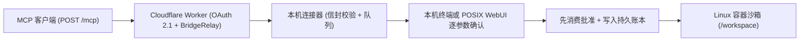

<h1 align="center">LoomWard · 织盾</h1>

<p align="center">
  <a href="LICENSE"></a>
  <a href="package.json"></a>
  <a href="pnpm-workspace.yaml"></a>
  <a href="wrangler.jsonc.example"></a>
</p>

<p align="center">
  <strong>简体中文</strong> | <a href="README.en.md">English</a>
</p>

<p align="center">
  <a href="https://agentdock-worker-remote.cbnv.me/">在线文档站</a> · <a href="docs-site/index.md">文档站源码</a> · <a href="repo-docs/README.md">源码阅读指南</a>
</p>

面向单人开发者的综合本地 Agent 安全管控平台（前身为 `AgentDock Bridge`，现已升级为 **LoomWard · 织盾** `pnpm workspace` monorepo）：以 **Cordis 4** 微内核、冻结根插件清单（RPM）与无状态 `PolicyTree` 为治理底座，结合 Cloudflare Workers OAuth 2.1 远程中继、跨平台（Windows / macOS / Linux）本机逐参人工审批、只读 Linux Docker 沙箱、第三方 MCP 聚合接入、R1–R7 防泄漏护栏与人机协作决策台账。

## Monorepo 结构与归档分支

仓库已按领域拆分为 `packages/*`（核心根包）与 `plugins/*`（严格进程外边界扩展插件），既有 v2 桥接运行时（`cloud/`、`local/`、`container/`、`scripts/`、`test/`）在迁移期间完整保留并持续回归验证：

| 工作区包 / 分支 | 包名 / 角色 | 边界与来源说明 |
| --- | --- | --- |
| `packages/shared` | `@loomward/shared` | 零宿主、零运行时依赖的共享契约、声明式 `console:panel@1` 与低耦合 `ContentInspect v1` 审查协议、RPM 摘要、60 秒 `BootRun` 回滚与单调安全插槽原语 |
| `packages/kernel` | `@loomward/kernel` | Cordis 4 微内核启动校验、`KernelGuard` AOP 守卫（闭锁 `vault:backend@1`、禁止 `tool:invoke@1@replace`）、`PolicyTree` 策略树与静态机械分层守卫（`pnpm run layering`） |
| `packages/cloud-relay` | `@loomward/cloud-relay` | Cloudflare Workers OAuth 2.1 + `BridgeRelay` 边缘中继根包（承接 `cloud/`） |
| `packages/sandbox` | `@loomward/sandbox` | 只读 Linux Docker 沙箱、`file-worker` 与 Windows ACL 守卫根包（承接 `container/` 与沙箱模块） |
| `packages/host` | `@loomward/host` | 跨平台受保护宿主运行时、凭据保管库、统一 `ToolDispatchPipeline`、审批状态机与 24h 防重放账本（承接 `local/` 与 `scripts/`） |
| `packages/console` | `@loomward/console` | 双源物理隔离回环控制台（Ring 2 Trust Origin `18798` 零扩展面板 + Ring 3 Console Origin `18797` 只读观测/SSE + `0600` `control.sock` 与离线 `esbuild` 构建前端） |
| `plugins/antileak` | `@loomward/plugin-antileak` | 进程外 R1–R7 离线防泄漏护栏插件（整合自 `archive/claude-code-antileak-hooks`，`ContentInspect v1` 前置 fail-closed 阻断 + 只读健康面板） |
| `plugins/decisions` | `@loomward/plugin-decisions` | 进程外人机决策台账与上下文导出插件（整合自 `archive/agent-decisions-dashboard`，回环 Python+SQLite 服务、CAS 乐观锁与幂等写入） |
| `plugins/mcp-hub` | `@loomward/plugin-mcp-hub` | 进程外 `stdio` / `Streamable HTTP` 第三方 MCP 聚合器（承接 `local/mcp-*.mjs`） |
| `plugins/adapters` | `@loomward/plugin-adapters` | 外部独立项目接口适配（OAuth 2.1/Streamable HTTP MCP 对接 `CloudForge`，只读 12s 超时观测对接 `ModelBridge`，不动其源码本体） |

历史单仓完整提交树已双端保留在以下存档分支，随时可检出对照：
- `archive/agentdock-worker-remote`（本仓库原 v2 桥接完整快照）
- `archive/agent-decisions-dashboard`（原人机决策台账完整快照）
- `archive/claude-code-antileak-hooks`（原双层防泄漏护栏完整快照）

## 核心能力与执行链路

- **边缘 OAuth 2.1 与代次隔离**：云端拆分授权（`AuthCoordinator`）与设备长连接（`BridgeRelay`）双 SQLite Durable Objects，强制 PKCE `S256`、零脚本 CSP 同意书与刷新令牌家族撤销；修改所有者密码即自动切换代次、立即作废旧授权。
- **本机单次精确批准与防重放**：除只读环境、任务查询与停止工具外，敏感调用均按完整参数计算摘要并等待本机人工复核。Windows 使用 `Approve.cmd`，Linux 和 macOS 可使用 `approve` 或受保护的回环 WebUI；重试时先删除批准文件再写入 24 小时持久账本，避免重复副作用。
- **Linux 只读容器沙箱与文件守卫**：Bash 命令与文件工具均在丢弃多余权能、默认 `--network none` 的一次性容器中运行（Windows/macOS 映射 UID 1000，原生 Linux 按非 root 宿主 UID/GID 动态映射），逐级检查符号链接、多硬链接、非法 UTF-16 与 Windows 自定义 NTFS ACL。
- **清理故障安全退守**：一旦容器清理未能确认，连接器立即拒绝后续新任务，同时保留属主客户端对其他已有任务的查询与停止权限，不虚报安全退出。
- **受保护运行副本与固定工具链**：安装流程把本地运行时与配置隔离到 `~/.agentdock-bridge`（Windows 为 `%USERPROFILE%\.agentdock-bridge`），校验祖先路径权限、系统凭据保护（Windows DPAPI / macOS Keychain / Linux Secret Service 或 `0600` 文件）与固定 Node `24.22.1` SHA-256 摘要，并清除 Node 与动态链接器覆盖环境变量。

## 能做到什么程度与明确不能做什么

| 维度 | 能做到什么程度（已实现能力） | 明确不能做什么（非目标与硬限制） |
| --- | --- | --- |
| 云端鉴权与连接 | OAuth 2.1 + PKCE S256、零脚本 CSP 同意页、密码改代次批量作废、`WSS /bridge` 反向穿透 | **不支持**多租户共享（仅单一 `owner`）与 SSE 响应流；Cloudflare 与 AI 平台可见传输正文 |
| 本机人工批准 | 除 `computer_context`、`command_status` 和 `stop_command` 外，均须通过本机终端或 POSIX WebUI 核对完整请求并批准一次 | 5 分钟 pending 超时（上限 64 条）；`504` 超时后**不自动重放**未确认写入；无头 Linux 若无 Keyring 服务需使用 `0600` 凭据文件 |
| 工具与容器沙箱 | 10 项 MCP 工具运行于 `--read-only` / `--cap-drop ALL` / 非特权 UID / `--network none` 一次性容器 | `/mcp` 限入站 `1 MiB` / 回包 `2 MiB` / `110s`；写文件 `<= 1 MiB`；清理未确认即闭锁新任务 |



工具结果、错误码与心跳状态沿本地连接器主动建立的 `WSS /bridge` 长连接反向回传给云端中继，再作为 `/mcp` 的 HTTP 响应返回客户端；日常启停、状态探针与连接密码查看统一经受保护目录 `~/.agentdock-bridge` 下的入口执行（Windows 为 `{Start,Stop,Status,Password,Approve}.cmd`，根目录同名 `.cmd` 仅作转发；Linux/macOS 为 `{start,stop,status,password,approve}`）。

## 快速开始

以下为单机生产接入的最简主路径（已登录 Cloudflare CLI 且本机 Docker 就绪；配置远端 MCP 客户端时填入 `https://<PUBLIC_ORIGIN>/mcp`）：

**Windows (PowerShell)**:

```powershell
pnpm install --frozen-lockfile && pnpm run check && pnpm test
Copy-Item wrangler.jsonc.example wrangler.jsonc   # 按实际域名修改 PUBLIC_ORIGIN
.\scripts\Setup.ps1 -Roots "<workspace-path>" -Origin "https://<your-bridge-domain>"
.\scripts\Secrets.ps1 -Action Upload
docker build -f container/Dockerfile -t agentdock-dev:2026-10-28 .
.\scripts\Install-Hardened.ps1 -Workspace "<workspace-path>"
pnpm run deploy
& "$env:USERPROFILE\.agentdock-bridge\Start.cmd"
```

**Linux / macOS (Bash / Zsh)**:

```sh
pnpm install --frozen-lockfile && pnpm run check && pnpm test
cp wrangler.jsonc.example wrangler.jsonc          # 按实际域名修改 PUBLIC_ORIGIN
node scripts/host-cli.mjs setup --roots "<workspace-path>" --origin "https://<your-bridge-domain>"
node scripts/host-cli.mjs upload-secrets
docker build -f container/Dockerfile -t agentdock-dev:2026-10-28 .
node scripts/host-cli.mjs install --workspace "<workspace-path>"
pnpm run deploy
~/.agentdock-bridge/start
```

Linux 与 macOS 的受保护安装还提供回环 WebUI。首次使用时在本机交互终端运行 `~/.agentdock-bridge/webui-auth init` 取得一次性初始化码。若控制台尚未运行，用 `~/.agentdock-bridge/webui` 启动，打开 `http://localhost:18797/` 完成认证，在「实时审计」页复核待批请求。

其他运行模式与平台差异入口：

| 部署 / 使用场景 | 适用环境与行为摘要 | 详细文档入口 |
| --- | --- | --- |
| 云端网关与本地开发调试 | Cloudflare Worker 配置、Secrets 上传与 `wrangler dev --ip 127.0.0.1 --port 8797` | [起步概览](docs-site/docs/index.md) · [配置矩阵](docs-site/docs/configuration.md) |
| 受保护宿主安装与密钥轮换 | `~/.agentdock-bridge`、固定 Node `24.22.1` SHA-256 校验、Keychain/DPAPI/Secret Service 与两步轮换 | [配置与宿主安装](docs-site/docs/configuration.md) |
| 容器镜像、网络出网与工具契约 | 10 项 MCP 工具上限、`network: "outbound"` 开关及 `file-worker` 无执行边界 | [接口与扩展契约](docs-site/docs/contracts.md) |
| 公网验收与停机生命周期探针 | 显式运行 `acceptance-v2.mjs` / `verify-lifecycle.mjs` 验证 OAuth 与健康探针 | [配置与验收操作](docs-site/docs/configuration.md) · [修复快照](SECURITY-FIXES.md) |
| 跨平台开发与回归验证 | 运行 `pnpm run check` 与 `pnpm test`（依赖 Windows DPAPI/ACL 或开启 Docker 的用例按环境条件跳过） | [源码阅读指南](repo-docs/README.md) · [常见边界与排错](docs-site/docs/faq.md) |

## 选型与边界 FAQ

- **为什么前端必须经由 Cloudflare Workers 而不是直接连接本地电脑？**

  远端 MCP 客户端要求公开且证书受信任的 HTTPS `/mcp` 与 OAuth 2.1 回调入口；Worker 充当边缘认证网关和反向 WebSocket 汇聚点，无需在家庭或办公路由器上开放任何入站端口。

- **是否支持多人共享或团队多租户使用？**

  不支持。网关所有授权令牌均映射单一宿主标识（`owner`）且只挂载一个显式工作区，多用户请各自独立部署 Worker 与本机连接器。

- **能否绕过 Cloudflare 或模型平台对数据的可见性？**

  不能。OAuth 凭证与 MCP 请求正文会经过 Cloudflare 边缘节点及调用方模型平台，本系统保护的是“未经批准不得触及本地环境”，而非端到端免信任密文传输。

- **使用 Docker 沙箱后，项目目录下的密钥是否安全？**

  容器对挂载工程具有读写权限以支持真实开发；已获批准的读操作或命令可访问工程内文件，且不可信文件内容中的提示词注入风险依然存在。

- **能否直接在 Linux 或 macOS 宿主机运行本地连接器？**

  支持。Windows 使用 `scripts/*.ps1`（DPAPI + NTFS ACL + PowerShell 5.1），Linux 与 macOS 使用 `scripts/host-cli.mjs`（配合 `local/host-safety.mjs`、`local/host-secrets.mjs` 与 `local/node-toolchains.mjs`）：macOS 默认将凭据存入登录 Keychain，Linux 桌面默认使用 Secret Service（`secret-tool`），无图形会话的 Linux 宿主可回退至 `0600` 权限私有凭据文件（`posix-file`），并均校验状态目录 `0700` 与祖先路径写保护。

## 文档与源码导航

| 读者目标 | 文档站入口 | 源码指南入口 |
| --- | --- | --- |
| 从零部署、配置参数与排查启动异常 | [起步与配置部署](docs-site/docs/index.md) · [排错 FAQ](docs-site/docs/faq.md) | [开发与运行边界说明](repo-docs/README.md) |
| 核对 OAuth 2.1、MCP 工具上限与批准契约 | [接口与扩展契约](docs-site/docs/contracts.md) · [API 与组件参考](docs-site/api-reference/index.md) | [云端网关](repo-docs/modules/cloud-oauth-and-relay.md) · [本地批准与账本](repo-docs/modules/local-approval-and-replay.md) · [容器与文件策略](repo-docs/modules/container-sandbox-and-file-policy.md) |
| 追踪一次请求流转、架构决策与源码改造入口 | [原理与源码导览](docs-site/docs/architecture.md) · [请求走查](docs-site/docs/walkthrough.md) | [一次真实操作走查](repo-docs/walkthroughs/one-real-run.md) · [代码地图](repo-docs/code-map.md) · [术语表](repo-docs/glossary.md) |
| 审计安全修复快照、漏洞披露与提交规范 | [架构决策与历史对照](docs-site/docs/architecture.md#安全决策与演进迁移) | [修复与验证快照](SECURITY-FIXES.md) · [源码证据审计](repo-docs/references/source-evidence.md) · [安全说明](SECURITY.md) |

## 许可与致谢

本项目遵循 [GNU Affero General Public License v3.0](LICENSE)（`AGPL-3.0-only`）开源发布，仅作个人授权接入与工程研究之用；云端 OAuth 基础能力基于 `@cloudflare/workers-oauth-provider`，在线文档站采用 VitePress 构建，`repo-docs/` 源码指南随代码变更同步维护。提交贡献前请阅读[贡献指南](CONTRIBUTING.md)并遵守[安全策略](SECURITY.md)中的离线扫描与秘密隔离约定。

- **附加条款与资产规则**：本项目依据 GNU AGPLv3 第 7 条适用 [`LICENSE-ADDITIONAL_TERMS-zh-CN.md`](LICENSE-ADDITIONAL_TERMS-zh-CN.md)（英文参考译文：[`LICENSE-ADDITIONAL_TERMS-en.md`](LICENSE-ADDITIONAL_TERMS-en.md)，以简体中文完整版正文为准），对来源陈述、修改标识、禁止冒充、扩展模块有条件附加许可及项目标识边界作出补充说明；工程落地参考见 [`IMPLEMENTATION-GUIDE.zh-en.md`](IMPLEMENTATION-GUIDE.zh-en.md)，人员署名、AI 辅助工具、上游/第三方代码及独立美术字体与标识资产综合清单见 [`ASSETS_LICENSES.md`](ASSETS_LICENSES.md)。附加要求与第 9.5–9.6 款附加许可豁免均分别核实相应版权持有人有效授权，未取得该等授权的第三方或上游材料仍受其原有有效许可约束。
